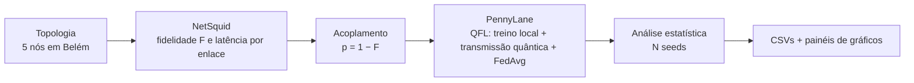

# qfl-innetwork

**Aprendizado de Máquina Quântico Federado *In-Network* sobre redes quânticas simuladas, aplicado ao monitoramento ambiental em Belém e região metropolitana.**

Este repositório integra duas camadas que costumam ser estudadas separadamente:

- a **rede quântica**, simulada com [NetSquid](https://netsquid.org), onde cada enlace de fibra tem perda, descoerência e atraso;
- o **aprendizado quântico federado**, implementado com [PennyLane](https://pennylane.ai), onde os parâmetros treinados em cada nó viajam até o hub **como estados quânticos** e sofrem a degradação do enlace.

A ideia central: a qualidade da rede quântica (fidelidade) limita a qualidade dos parâmetros que chegam ao agregador, logo **a rede faz parte do aprendizado**.

> **Status:** prova de conceito. Os dados ambientais são **sintéticos** (gerados por código). A troca por dados reais (INMET, INPE) é o próximo passo previsto.

---

## Sumário

1. [Visão geral](#1-visão-geral)
2. [O cenário de Belém](#2-o-cenário-de-belém)
3. [Requisitos](#3-requisitos)
4. [Instalação passo a passo](#4-instalação-passo-a-passo)
5. [Como executar](#5-como-executar)
6. [O que o experimento produz](#6-o-que-o-experimento-produz)
7. [Como funciona (resumo técnico)](#7-como-funciona-resumo-técnico)
8. [Configuração](#8-configuração)
9. [Estrutura do repositório](#9-estrutura-do-repositório)
10. [Como estender](#10-como-estender)
11. [Solução de problemas](#11-solução-de-problemas)
12. [Limitações conhecidas](#12-limitações-conhecidas)
13. [Autoria, licença e citação](#13-autoria-licença-e-citação)

---

## 1. Visão geral



Fluxo de cada rodada federada:

1. o hub distribui o modelo global;
2. cada nó treina localmente nos **seus** dados (que nunca saem do nó);
3. os parâmetros de cada nó são codificados em qubits, atravessam o canal com o ruído do seu enlace e são medidos pelo hub;
4. o hub agrega (FedAvg) e gera o novo modelo global.

---

## 2. O cenário de Belém

O cenário representa uma rede quântica em **escala metropolitana**, com o hub no GERCOM/UFPA. As distâncias são curtas (até 17 km), compatíveis com o que redes quânticas sem repetidor conseguem cobrir hoje.

| Rótulo | Local | Distância até o hub |
|---|---|---|
| `GERCOM` | GERCOM/UFPA (**Hub**) | 0,2 km |
| `PCT` | PCT Guamá | 1,5 km |
| `MPEG` | Museu Paraense Emílio Goeldi (Campus de Pesquisa) | 3,0 km |
| `SEMAS` | SEMAS | 5,0 km |
| `SEMA` | SEMA (Ananindeua) | 17,0 km |

A topologia está definida em `cenario_belem.py`:

```python
TOPOLOGIA_BELEM = [
    ("GERCOM", "GERCOM/UFPA (Hub)",   0.2),
    ("PCT",    "PCT Guamá",           1.5),
    ("MPEG",   "Museu Emílio Goeldi", 3.0),
    ("SEMAS",  "SEMAS",               5.0),
    ("SEMA",   "SEMA (Ananindeua)",  17.0),
]
```

### Exemplo de fidelidades medidas

Em uma execução de exemplo, o NetSquid mediu as fidelidades abaixo (os valores variam um pouco entre execuções, pois a simulação é Monte Carlo):

| Nó | Distância | Fidelidade (F) |
|---|---|---|
| GERCOM | 0,2 km | ≈ 0,99 |
| PCT | 1,5 km | ≈ 0,91 |
| MPEG | 3,0 km | ≈ 0,90 |
| SEMAS | 5,0 km | ≈ 0,87 |
| SEMA | 17,0 km | ≈ 0,65 |

Nesse exemplo, quatro dos cinco nós ficam acima do limiar de fidelidade (≈ 0,75) identificado no experimento controlado de robustez. Apenas o SEMA fica abaixo dele, e isso aparece nos gráficos: o erro de recuperação dos parâmetros desse nó é visivelmente maior, enquanto a acurácia global do sistema se mantém, pois o FedAvg dilui a contribuição de um nó ruidoso entre cinco.

### Dados

Os dados são **sintéticos**: quatro *features* ambientais por amostra (temperatura, PM2.5, umidade do solo e NDVI), com rótulo de risco em {−1, +1} gerado por uma regra fisicamente plausível (calor e poluição aumentam o risco; solo úmido e vegetação densa reduzem). Cada nó recebe sua própria partição. Detalhes em `qfl_innetwork/data.py`.

---

## 3. Requisitos

| Item | Versão testada | Observação |
|---|---|---|
| Sistema operacional | Linux ou macOS | O NetSquid **não** suporta Windows nativo. No Windows, use **WSL2** |
| Python | 3.12 | |
| NetSquid | 1.1.8 | Exige conta gratuita (ver abaixo) |
| PennyLane | 0.45.x | |
| NumPy | **1.26.4** | NumPy 2.x quebra a extensão compilada do NetSquid |
| Matplotlib | ≥ 3.7 | O código é compatível com ≥ 3.9 (`tick_labels`) |
| pandas | ≥ 2.0 | Usado na exportação dos CSVs |

**O NetSquid é obrigatório.** Sem ele, o programa encerra com uma mensagem de erro explicando como instalar.

---

## 4. Instalação passo a passo

### 4.1 Crie a conta no NetSquid

O NetSquid é distribuído por um índice de pacotes próprio, com acesso mediante conta **gratuita**:

1. Acesse <https://netsquid.org> e crie uma conta.
2. Guarde seu usuário e senha. Eles serão pedidos na instalação.

### 4.2 Clone o repositório

```bash
git clone https://github.com/<seu-usuario>/qfl-innetwork.git
cd qfl-innetwork
```

### 4.3 Crie e ative um ambiente virtual

```bash
python3.12 -m venv venv
source venv/bin/activate
python -m pip install --upgrade pip
```

### 4.4 Instale as dependências comuns

```bash
pip install -r requirements.txt
```

Isso instala `numpy==1.26.4`, `pennylane`, `matplotlib` e `pandas`.

### 4.5 Instale o NetSquid

```bash
pip install --extra-index-url https://pypi.netsquid.org netsquid
```

O `pip` pedirá o usuário e a senha da sua conta. Se preferir informar as credenciais na própria URL:

```bash
pip install --extra-index-url https://<usuario>:<senha>@pypi.netsquid.org netsquid
```

> **Segurança:** nunca grave usuário e senha em arquivos versionados, scripts ou no histórico compartilhado. O `requirements.txt` deste repositório intencionalmente **não** inclui o NetSquid.

### 4.6 Confira a instalação

```bash
python -c "import netsquid, pennylane, numpy; print('NetSquid', netsquid.__version__); print('PennyLane', pennylane.version()); print('NumPy', numpy.__version__)"
```

A saída esperada é algo como `NetSquid 1.1.8`, `PennyLane 0.45.x` e `NumPy 1.26.4`.

### 4.7 Usuários de Windows

Instale o WSL2 com uma distribuição Ubuntu, abra o terminal do Ubuntu e siga os passos 4.2 a 4.6 dentro dele.

---

## 5. Como executar

### Cenário de Belém

```bash
python cenario_belem.py
```

O script executa, em ordem:

1. **Rede quântica:** mede fidelidade e latência de cada enlace com o NetSquid;
2. **Experimentos:** federado com transmissão ideal, federado com transmissão quântica e baseline centralizado, repetidos em várias seeds, mais as varreduras controladas (robustez e heatmap);
3. **Teste estatístico:** t pareado entre transmissão ideal e quântica;
4. **Exportação:** CSVs;
5. **Gráficos:** dois painéis.

### Execução genérica (topologia padrão)

```bash
python main.py
```

Usa a topologia padrão do `Config` (cenário amazônico de longa distância). Para o seu próprio cenário, crie um script como o `cenario_belem.py`.

### Tempo de execução

O tempo cresce de forma aproximadamente linear com `N_SEEDS`, `RODADAS` e o número de nós. Para validar a instalação, comece com os valores padrão (10 seeds) e só depois aumente para o setup de publicação (seção 8).

---

## 6. O que o experimento produz

Tudo é salvo em `resultados_belem/`.

### Gráficos

| Arquivo | Conteúdo | Rede usada |
|---|---|---|
| `painel_rede_real.png` | **(A)** convergência ± desvio, **(B)** acurácia final (boxplot), **(C)** erro de recuperação por nó, **(F)** ângulo enviado × recuperado | **Real**: fidelidades medidas pelo NetSquid em cada nó |
| `painel_rede_uniforme.png` | **(D)** robustez (acurácia × fidelidade), **(E)** heatmap fidelidade × shots | **Uniforme**: todos os nós com a mesma fidelidade, para isolar a variável |

**Por que dois tipos de rede?** A rede **real** retrata o sistema concreto. A rede **uniforme** é um experimento controlado: variando só a fidelidade (e os shots), é possível atribuir a causa de qualquer mudança na acurácia, o que não seria possível com cinco fidelidades diferentes ao mesmo tempo.

### CSVs (`resultados_belem/csv/`)

Todos os arquivos têm as colunas `modelo` e `agregador`, para que você execute variações, concatene os resultados e compare.

| Arquivo | Conteúdo |
|---|---|
| `rede.csv` | Distância, fidelidade, latência, ruído `p` e shots por nó |
| `acuracia_final.csv` | Acurácia final por seed e método (centralizado, federado ideal, federado quântico) |
| `convergencia.csv` | Acurácia por rodada, seed e método |
| `erro_por_no.csv` | Média, desvio, mediana e quartis do erro de recuperação por nó |
| `robustez.csv` | Acurácia média ± desvio em função da fidelidade |
| `heatmap.csv` | Acurácia por combinação (fidelidade, shots) |
| `resumo.csv` | Médias finais e teste estatístico |

Exemplo de comparação entre execuções:

```python
import glob
import pandas as pd

df = pd.concat(pd.read_csv(f) for f in glob.glob("resultados_*/csv/acuracia_final.csv"))
print(df.groupby(["modelo", "agregador", "metodo"]).acuracia.agg(["mean", "std"]).round(3))
```

---

## 7. Como funciona (resumo técnico)

### Rede quântica (NetSquid)

Para cada nó, o código cria um canal de fibra com três modelos físicos: atraso (`FibreDelayModel`), perda de fótons (`FibreLossModel`, 0,2 dB/km) e descoerência (`DepolarNoiseModel`). Um par de Bell |Φ⁺⟩ é gerado, um dos qubits viaja pelo canal e a **fidelidade** do par recebido é medida. O processo é repetido `N_RUNS_NET` vezes (Monte Carlo) e a média é usada. Um fóton perdido conta como estado maximamente misto (F = 0,25).

### Acoplamento rede → aprendizado

Passando um qubit de um par de Bell por um canal despolarizante de intensidade `p`, a fidelidade do par é exatamente `F = 1 − p`. Como é essa fidelidade que o NetSquid mede, o ruído injetado no circuito é:

```
p = 1 − F
```

O orçamento de medições (shots) de cada nó também cai com a qualidade do enlace: `shots = max(8, BASE_SHOTS · F³)`.

### Modelo (PennyLane)

Classificador Quântico Variacional (VQC):

- **Codificação:** `AngleEmbedding` (rotações RY), uma *feature* por qubit;
- **Parte treinável:** `StronglyEntanglingLayers`;
- **Leitura:** valor esperado ⟨Z₀⟩, cujo sinal define a classe;
- **Dimensões:** 4 qubits × 4 camadas × 3 ângulos = **48 parâmetros**;
- **Treino:** Adam, com *backpropagation* no simulador.

### Agregação via estados quânticos

Cada parâmetro θ é codificado em `RY(θ)|0⟩`, passa pelo canal despolarizante do enlace do seu nó e é medido pelo hub (⟨Z⟩ e ⟨X⟩, com número finito de shots). O ângulo é recuperado por:

```
θ̂ = atan2(⟨X⟩, ⟨Z⟩)
```

O ruído despolarizante encolhe ⟨Z⟩ e ⟨X⟩ pelo mesmo fator, que se cancela na razão. O que degrada de fato a recuperação é a variância da medição com shots finitos, que piora conforme o enlace piora. Depois da recuperação, o hub faz a média dos nós (FedAvg).

### Métodos comparados

| Método | O que representa |
|---|---|
| **Centralizado** | Todos os dados reunidos em um só lugar (referência sem federação) |
| **Federado ideal** | Federado com transmissão perfeita dos parâmetros (referência sem ruído de rede) |
| **Federado quântico** | Federado com os parâmetros transmitidos pela rede quântica simulada |

---

## 8. Configuração

Todos os parâmetros ficam na dataclass `Config` (`qfl_innetwork/config.py`).

| Parâmetro | Padrão | Significado |
|---|---|---|
| `N_QUBITS` | 4 | Qubits do circuito (= número de *features*) |
| `N_LAYERS` | 4 | Camadas do ansatz |
| `LR` | 0,15 | Taxa de aprendizado do Adam |
| `EPOCAS_LOC` | 6 | Épocas de treino local por rodada |
| `RODADAS` | 5 | Rodadas federadas |
| `BASE_SHOTS` | 256 | Shots do melhor enlace |
| `N_RUNS_NET` | 80 | Repetições Monte Carlo por enlace (NetSquid) |
| `N_SEEDS` | 10 | Repetições do experimento (estatística) |
| `N_LOCAL` | 70 | Amostras por nó |
| `N_TESTE` | 120 | Amostras do conjunto de teste global |
| `TOPOLOGIA` | Amazônia (4 nós) | Lista `(rótulo, local, distância_km)` |
| `OUTDIR` | `resultados` | Pasta de saída |

### Setup sugerido para resultados de publicação

Para intervalos de confiança mais apertados, mude apenas os parâmetros que aumentam o rigor estatístico, sem alterar o fenômeno:

```python
cfg = Config(
    TOPOLOGIA=TOPOLOGIA_BELEM,
    OUTDIR="resultados_belem",
    RODADAS=8,
    N_RUNS_NET=150,
    N_SEEDS=30,      # mínimo usual para reportar média ± desvio
    N_LOCAL=100,
    N_TESTE=300,     # reduz bastante o intervalo de confiança da acurácia
)
```

---

## 9. Estrutura do repositório

```
qfl-innetwork/
├── README.md
├── requirements.txt
├── main.py                    # execução genérica (topologia padrão)
├── cenario_belem.py           # cenário de Belém (5 nós)
└── qfl_innetwork/
    ├── config.py              # setup: dataclass Config
    ├── netsquid_backend.py    # rede quântica + acoplamento p = 1 − F
    ├── qml.py                 # BaseQMLModel, VQCModel, QNNModel
    ├── federated.py           # transmissão + agregação + laço federado
    ├── data.py                # dados sintéticos
    ├── experiments.py         # coleta (seeds, robustez, heatmap, scatter)
    ├── analysis.py            # teste estatístico (t pareado)
    ├── export.py              # exportação dos CSVs
    └── plots.py               # painéis de gráficos
```

---

## 10. Como estender

O projeto foi modularizado para você trocar componentes sem reescrever o restante.

### Trocar o modelo (por exemplo, VQC → QNN)

No script de execução (`cenario_belem.py` ou `main.py`):

```python
from qfl_innetwork.qml import QNNModel

model = QNNModel(cfg.N_QUBITS, cfg.N_LAYERS)   # em vez de VQCModel
```

O `QNNModel` incluído é um ponto de partida: usa *data re-uploading* sobre o mesmo ansatz do VQC. Para uma QNN própria, crie uma subclasse de `BaseQMLModel` e implemente o circuito.

### Trocar a estratégia de agregação

```python
from qfl_innetwork.federated import FedMedian

aggregator = FedMedian()   # em vez de FedAvg()
```

Para criar a sua, herde de `BaseAggregator` e implemente `aggregate(lista_pesos, tamanhos=None)`. Exemplos naturais: média aparada, Krum, média ponderada pela fidelidade do enlace, FedProx.

### Trocar a transmissão

`IdealTransmission` (sem ruído) e `QuantumStateTransmission` (estados quânticos) seguem a interface `BaseTransmission`. Você pode implementar, por exemplo, uma transmissão clássica com quantização para servir de baseline.

### Trocar a topologia

Edite a lista de nós (rótulo, local, distância em km). Nada mais precisa mudar: fidelidade, shots, partições de dados, gráficos e CSVs se ajustam ao número de nós.

### Trocar os dados

Reescreva `data.gerar_particao`, mantendo o formato de saída: `X` escalado para `[0, π]` e `y` em `{−1, +1}`.

### Comparar execuções

Use um `OUTDIR` e um `MODELO`/`AGREGADOR` diferentes em cada execução e compare os CSVs (exemplo na seção 6).

---

## 11. Solução de problemas

| Sintoma | Causa provável | Solução |
|---|---|---|
| `ERRO: este projeto EXIGE o NetSquid` | NetSquid não instalado | Siga a seção 4.5 |
| Erro de importação ao carregar o `netsquid` mencionando incompatibilidade binária do NumPy | NumPy 2.x instalado | `pip install "numpy==1.26.4"` |
| `pip` não encontra o `netsquid` ou retorna erro 401 | Credenciais ausentes ou incorretas | Confirme usuário e senha da conta em netsquid.org |
| `netsquid` não instala no Windows | Sem suporte nativo | Use WSL2 |
| `TypeError: boxplot() got an unexpected keyword argument 'labels'` | Matplotlib ≥ 3.9 | Já tratado em `plots.py` (detecção automática de versão). Se aparecer, atualize o repositório |
| Execução muito lenta | `N_SEEDS`, `RODADAS` ou número de nós altos | Reduza para depurar e aumente só na execução final |
| Fidelidades muito baixas em enlaces longos | Perda de fibra padrão (0,2 dB/km) | Comportamento físico esperado. Veja a seção 12 |

---

## 12. Limitações conhecidas

- **Dados sintéticos e IID.** Dados reais costumam ser não-IID entre regiões, e é nesse cenário que a federação mais se diferencia do treino centralizado. A integração com INMET (clima), INPE (focos de calor) e NDVI é o próximo passo.
- **Sem repetidores ou purificação.** Em distâncias longas (dezenas de km) a perda da fibra padrão degrada o enlace a ponto de destruir o aprendizado. A escala metropolitana de Belém evita esse regime, mas a modelagem de purificação de emaranhamento e de repetidores é trabalho futuro.
- **Escala do simulador.** A simulação com ruído usa matriz densidade, cujo custo cresce exponencialmente com o número de qubits. Por isso o modelo usa 4 qubits.
- **Heatmap com rodadas fixas.** Em `experiments.py`, o bloco do heatmap usa 4 rodadas federadas fixas, independentemente de `RODADAS`. Isso mantém o heatmap comparável entre execuções, mas vale saber ao variar `RODADAS`.
- **Comparações com poucas seeds.** Com `N_SEEDS` baixo, é comum que o federado quântico supere o ideal por acaso. Para conclusões, use 30 seeds ou mais.

---

## 13. Autoria, licença e citação

**Autor:** Mateus Bastos Araújo, Programa de Pós-Graduação em Ciência da Computação, Universidade Federal do Pará (UFPA).

**Licença:** _a definir_ (sugestão: MIT ou Apache-2.0). Adicione o arquivo `LICENSE` antes de tornar o repositório público.

**Como citar:** _a preencher após a publicação do artigo/dissertação._

```bibtex
@misc{qfl_innetwork,
  author = {Araújo, Mateus Bastos},
  title  = {qfl-innetwork: Federated Quantum Machine Learning over Simulated Quantum Networks},
  year   = {2026},
  note   = {Código-fonte: https://github.com/<seu-usuario>/qfl-innetwork}
}
```

### Agradecimentos às ferramentas

[NetSquid](https://netsquid.org) (simulação de redes quânticas) e [PennyLane](https://pennylane.ai) (aprendizado de máquina quântico).